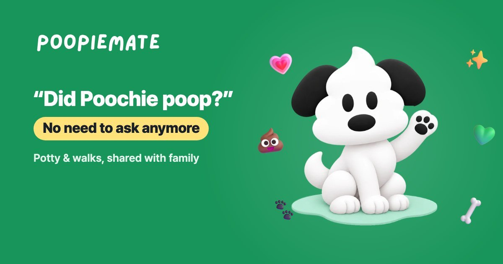
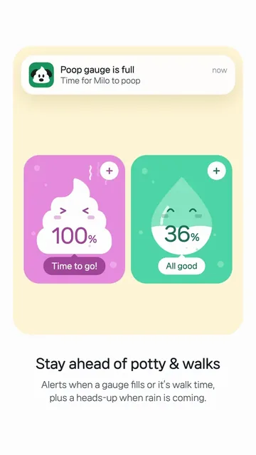

# 👾 Jin Yi (이진)

Frontend Engineer with a product-driven mindset. 
I care about shipping things that work, scale, and look great. 
Specialized in building real-world, user-facing interfaces — fast.

---

## 💩 POOPIEMATE · 응가메이트

**Your dog’s potty log, shared with the whole family.** 
가족이 함께 보는 우리 강아지 응가 기록.

I design and build POOPIEMATE on my own, from the app to the website. 
It started with our own dog, who only goes outside, and the “Did Poochie poop?” calls we made every day.

- 🔑 **One code brings everyone in** — invite your family with a single code
- 🐾 **One tap, every phone buzzes** — log a poop, pee or walk and the whole family gets an alert
- 💗 **Hearts & help requests** — thank them for the walk, or ask for one on a busy day
- 🌤️ **Walk safety** — an hourly score fitted to your dog and the weather

  
  
  
  

  
  
  
  

  
  
  
  
  

**Built with** Expo · React Native · TypeScript · Supabase · NativeWind · Reanimated · Zustand · i18next
